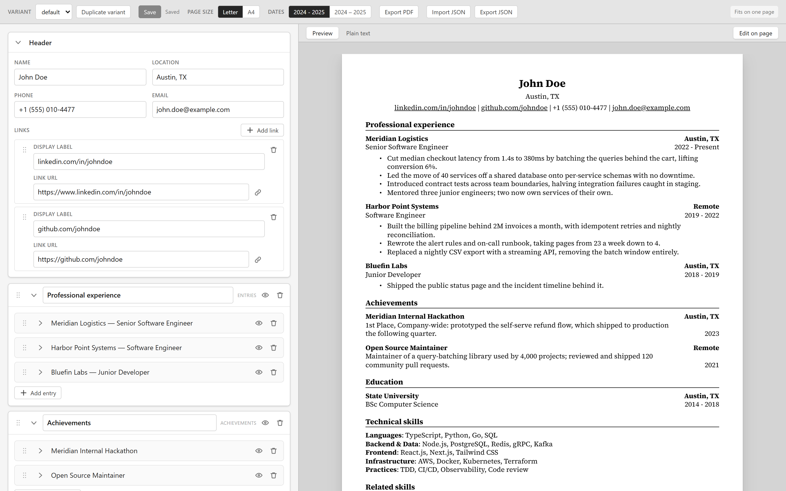

# Resume Builder

A local, single-column resume builder with a print-accurate live preview. The
content is structured JSON edited through a form UI; the right pane renders the
document at real page size (Letter or A4), so what you see is what the PDF
gets.

No database, no account, no network calls. The document never leaves the
machine. The same app also builds as a static [web demo](#web-demo-vercel)
that keeps each visitor's resumes in their own browser.



## Quick start

You do not need to be a developer to run it. You need:

- **Node.js 22.12 or newer.** Get the LTS version from
  [nodejs.org](https://nodejs.org/). `node --version` shows the one you have.
- **Git**, from [git-scm.com](https://git-scm.com/downloads), to download the
  app and its updates.
- **Google Chrome or Microsoft Edge** (optional). With one of them installed,
  **Export PDF** saves the file in one click. Without either, use **Print
  instead** and save the PDF from the print dialog.

Then, in a terminal (PowerShell or Command Prompt on Windows, Terminal on macOS
and Linux):

```bash
git clone https://github.com/Juan-Hernandez-Dev/Resume_Builder.git
cd Resume_Builder
npm install
npm run app
```

Open http://127.0.0.1:3000. `npm run app` builds the app and then serves it,
so the first start takes a minute. Keep the terminal open while you use it and
press <kbd>Ctrl</kbd>+<kbd>C</kbd> there to stop it; next time, run
`npm run app` again from the `Resume_Builder` folder.

**A fresh clone opens an empty resume.** The first page load creates the
`data/` folder and an empty `data/default.json` (the `default` variant) for
you to fill in. To start from the bundled placeholder resume (John Doe)
instead, either copy it in **before the first run**:

```bash
# macOS / Linux
mkdir -p data && cp examples/john-doe.json data/default.json
```

```powershell
# Windows (PowerShell)
New-Item -ItemType Directory -Force data | Out-Null; Copy-Item examples\john-doe.json data\default.json
```

or, at any time, open the app and click **Load example**, which opens it as
its own variant, `example`, next to yours.

**Where your resume is stored:** in the `data/` folder inside `Resume_Builder`,
one JSON file per version of your resume. Git ignores every JSON file there, so
your resume never ends up in a commit and updating the app leaves it alone. The
app never treats `examples/` as a variant: the placeholder is only a starting
point to copy, import or open with **Load example**. Copy the `data/` folder somewhere safe to back it up.

**To update** to the latest version, stop the app, then:

```bash
git pull
npm install
npm run app
```

## Why it exists

Resume tools tend to make you pick between a WYSIWYG editor that fights you
over a single line break and a LaTeX template that needs a recompile to see a
change. This keeps the content as data and the layout as CSS, so the content
stays editable as a form while the page stays exact.

One constraint shapes the whole design: a resume is **one page**. So the
preview is the real page at real size, and an indicator in the toolbar tells
you the moment the document stops fitting.

## Stack

Next.js 16 (App Router, Turbopack) · React 19 · TypeScript · Tailwind CSS v4 ·
zod · dnd-kit · vitest

~14,600 lines across 117 source files, covered by 512 unit tests.

## Design notes

The decisions worth a look, if you are reading this as a code sample:

- **One schema, one source of truth.** `lib/schema.ts` is a zod schema that
  every layer parses through: both API routes, the editor, the file reader and
  the tests. Every optional field carries a default, so a half-written JSON
  file still opens in the editor instead of crashing it.
- **Writes are atomic.** A save is written to a `.tmp` file and then renamed
  over the target, leaving a rolling `.bak` behind. A crash mid-write cannot
  leave a truncated resume on disk.
- **Filesystem errors are translated, never leaked.** `lib/fs-errors.ts` maps
  error *codes* to one actionable sentence each and deliberately never echoes
  the absolute path Node puts in `error.message`. A full disk reads as a full
  disk instead of an opaque `HTTP 500`.
- **Variant names are an allowlist, checked twice.** They become filenames, so
  they are restricted to `[a-z0-9-_]`, and the resolved path is then verified
  to still sit inside `data/`.
- **Storage sits behind a port.** The editor never knows where variants
  live: it talks to a `ResumeRepository` (`lib/storage/port.ts`) handed to
  it by `components/platform/PlatformProvider.tsx`. Locally that is the API
  routes over the files in `data/`; one shared contract suite pins the
  behaviour every adapter (filesystem, IndexedDB, memory) must keep.
- **Component caching is off on purpose.** `next.config.ts` explains why: with
  it on, the build bakes the JSON into its output and saves appear to do
  nothing. For a disk-backed editor that is a correctness bug, not a
  performance trade-off.

## How to run

For development, with hot reload (Node.js 22.12 or newer, as `engines` in
`package.json` says; `.nvmrc` picks Node 24 for nvm users):

```bash
npm install
npm run dev
```

Then open http://127.0.0.1:3000. To run the production build instead, use
`npm run app` (build, then serve), as in the quick start.

On a fresh clone there is no resume yet: the first page load seeds an empty
`default` variant in `data/default.json`. To start from the placeholder in
`examples/john-doe.json` instead, copy it in before the first run, or click
**Load example** in the app (it creates `data/example.json`):

```bash
# macOS / Linux
mkdir -p data && cp examples/john-doe.json data/default.json
# Windows (PowerShell)
New-Item -ItemType Directory -Force data | Out-Null; Copy-Item examples\john-doe.json data\default.json
```

After the first run `data/default.json` already exists (the seeded empty
resume), and copying over it replaces it; Import JSON is the safer route then.

`dev`, `start` and `app` all bind to `127.0.0.1` on purpose. The API reads and writes
the files under `data/` and has no authentication, because it is meant for one
person on one machine. Bound to every interface, anyone on the same network
could read and overwrite the resume. If you do want it reachable from another
device, pass the host explicitly: `npm run dev -- -H 0.0.0.0`.

## Your resume stays out of git

`data/*.json` is gitignored, with no exception, and the repository ships no
file in `data/`. The placeholder resume lives in `examples/john-doe.json`
instead: a variant committed in `data/` would be opened on a fresh clone in
place of the seeded empty one, and autosave would then write your resume into
a tracked file.

That is deliberate: a resume holds your real name, phone number and email
address, and a repo is the wrong place for them. Your variants live on your
disk and are never committed. If you fork this to keep your own resume in a
**private** repo, remove the `/data/*.json` line from `.gitignore`.

Other scripts:

| Script              | What it does                           |
| ------------------- | -------------------------------------- |
| `npm run app`       | Build, then serve it (the quick start) |
| `npm run dev`       | Development server                     |
| `npm run build`     | Production build                       |
| `npm run build:web` | Static web demo in `out/`, then `check:web` |
| `npm run check:web` | Checks `out/`: no API calls, no puppeteer |
| `npm start`         | Serve the production build             |
| `npm test`          | Unit tests (vitest)                    |
| `npm run test:watch`| Same tests, in watch mode              |
| `npm run typecheck` | `tsc --noEmit`                         |
| `npm run lint`      | ESLint                                 |

## Web demo (Vercel)

The same code builds a second app: a static site anyone can open, with no
server behind it. Set `NEXT_PUBLIC_APP_MODE=web` (what `npm run build:web`
does) and the build swaps the filesystem page for one that runs entirely in
the browser.

What differs from the local app:

- **Storage is the visitor's browser.** Every variant is kept in IndexedDB, on
  the visitor's own machine; nothing is ever sent to a server, and there is no
  account. Clearing the site's data, or another browser or device, means no
  resumes. A note under the toolbar says so, and the app asks the browser to
  keep the data after the first save (`navigator.storage.persist()`).
- **Back up with Export JSON.** That file is the only copy that lives outside
  the browser; Import JSON brings it back.
- **Export PDF opens the print dialog**, since there is no Chrome to drive on a
  static host. The settings that make the PDF match the preview are shown next
  to the button (Save as PDF, Margins: None, Background graphics off, Headers
  and footers off).
- **Load example** opens the John Doe placeholder as the variant `example`; a
  first visit starts on an empty `default`, as a fresh clone does.
- A browser with no usable IndexedDB (some private windows) still gets a
  working editor, kept in memory, with a warning that nothing outlives the tab.

How the build is split: files only one app needs carry it in their name.
`page.local.tsx`, `print/page.local.tsx` and every `route.local.ts` exist only
in the local build, `page.web.tsx` only in the web one, and a `.web.ts(x)`
sibling stands in for a client module whose local version calls the API (see
`next.config.ts`). The web build is a static export, and `npm run check:web`
fails it if `out/` still mentions puppeteer or calls `/api/`.

Build and preview it locally:

```bash
npm run build:web
npx serve out
```

Deploy on Vercel by importing the repository with these project settings:

| Setting              | Value                                              |
| -------------------- | -------------------------------------------------- |
| Framework preset     | Next.js                                            |
| Environment variable | `NEXT_PUBLIC_APP_MODE=web`, for Production and Preview |
| Node.js version      | 24.x                                               |
| Build command        | `npm run build:web` (also set in `vercel.json`)     |
| Output directory     | `out`, only if Vercel does not detect it           |

`vercel.json` also sets the security headers for every route: a
Content-Security-Policy that allows nothing but this origin (fonts are
self-hosted by `next/font`, so `font-src 'self'` is enough), no referrer,
`nosniff`, no camera, microphone or location, and HSTS.

## Using the editor

The screen is two panes with a toolbar on top:

- **Left**: the forms. The header, then one collapsible card per section, each
  holding one collapsible card per entry.
- **Right**: the live page at real size, scaled to fit the pane, plus a
  **Plain text** tab that shows the resume the way an ATS reads it (same order,
  same line breaks, no markup) with a **Copy** button.
- **Toolbar**: variant picker, Duplicate variant, Load example, Save, page size, date
  separator, Export PDF, Import/Export JSON and the page-overflow indicator.

### Editing

- Sections, entries, bullets and header links can be added, edited, deleted and
  reordered. Sections and entries can also be hidden: a hidden item stays in the
  JSON file and disappears from the page and from the plain text.
- Section titles are edited in place, in the card header.
- **Header links** have two fields: the **Display label** is the text printed
  on the page (for example `linkedin.com/in/johndoe`) and the **Link URL** is
  where it points. The link button next to the URL copies the label across:
  it trims it, adds `https://` when there is no scheme, keeps an existing
  `http://` or `https://` as is, and turns an email address into a `mailto:`
  link. A link with no label prints its URL.
- **Reordering** works by dragging the grip handle, or from the keyboard: focus
  a grip handle, press <kbd>Space</kbd>, move with <kbd>↑</kbd>/<kbd>↓</kbd>,
  press <kbd>Space</kbd> again to drop (<kbd>Esc</kbd> cancels). Only the handle
  starts a drag, so the text inputs stay usable.
- **Skills** items are edited as one comma-separated input and stored as an
  array. **Known limitation**: the comma is the separator, so an item cannot
  contain one. A stored item such as `"REST, GraphQL"` shows correctly but is
  split into two items on the next keystroke in that field. Edit the JSON file
  directly if an item really needs a comma.
- **Bullets** have a soft counter that warns past 140 characters. It never
  blocks: it is a reminder that a bullet should stay on one or two lines.
- Which cards are open is interface state only; it is never written to the JSON.

### Saving

- Autosave writes the file 800ms after you stop typing. A save already in
  flight is never interrupted; a change that arrives during one is written right
  after it.
- The dot next to **Save** means there are unsaved changes. Otherwise the
  toolbar shows when the last save happened.
- **Save** forces a write immediately.
- If the server rejects a write, the toolbar shows the reason (including which
  field failed) and the changes stay in the editor, unsaved. A failed write is
  retried on its own after 1s, 3s and 8s, which is enough for a file lock from
  an antivirus scan or an open editor to clear. After that the error stays on
  screen and **Save** retries.
- Closing the tab with unsaved changes asks for confirmation first.
- Switching or duplicating a variant writes pending changes first, and refuses
  to switch if that write fails. The variant picker is disabled while a variant
  is being opened, and anything typed while one is loading is written to the
  variant you were on, not to the one you are opening.

#### How a write reaches the disk

Every write goes to a temp file in `data/`, is flushed, and is then renamed
over the target, so a crash, a full disk or a file lock can never leave a
half-written variant. The previous contents are kept as a single rolling
`data/<variant>.json.bak` first, which is the file to copy back if a variant
ever needs recovering by hand. Only `*.json` counts as a variant, so neither
the `.bak` nor a temp file shows up in the variant list.

### If a variant will not open

A variant file that is not valid JSON, or no longer matches the schema, does
not take the app down. The editor is replaced by a recovery screen that names
the file, lists exactly which fields do not match, lets you open any other
variant, and can overwrite the broken file with a JSON export. The broken file
is left alone until you choose to replace it. The same screen appears when the
`data/` directory itself cannot be read.

### Import / export JSON

**Export JSON** downloads the document as `<variant>.json`. **Import JSON**
validates the file against the schema and loads it into the current variant as
an unsaved change, so autosave then writes it to that variant's file. Because
that overwrites the current variant's file about a second later, importing over
a document that has anything in it asks for confirmation, and pending edits are
written to the current variant before the import replaces them. Files over 2 MB
are refused without being read. Import never creates a variant: duplicate first
if you want a new file.

## How variants work

Every resume variant is one JSON file in `data/`:

```
data/default.json     -> variant "default"
data/frontend.json    -> variant "frontend"
```

The file name (without `.json`) is the variant name. Names are restricted to
`[a-z0-9-_]` so they can never escape the `data/` directory.

On a fresh clone there is no `data/` directory at all: git does not track
empty directories, and nothing in `data/` is committed. The first page load
creates it and seeds an empty `data/default.json` whenever `data/` holds no
variant, because `PUT` deliberately refuses to create files and there would
otherwise be nothing to save into. An existing variant is never touched by
this.

`/?variant=<name>` opens a specific variant on load. The toolbar's picker
switches variants without reloading; the query parameter exists so the recovery
screen can still reach another variant when the current one is the broken file.

**Duplicate variant** in the toolbar asks for a name, cleans it up to fit that
rule (and asks before using the cleaned-up version), copies the current
variant's file and switches to it. A name that is already taken is reported
instead of overwritten.

**Load example** opens the placeholder resume (John Doe) as the variant
`example`, creating it from `examples/john-doe.json` the first time and simply
opening it after that, so edits made to it are never overwritten. Pending
changes to the variant on screen are written first.

To start a new variant by hand, copy an existing file:

```bash
cp data/default.json data/frontend.json
```

The variant list is read on page load, so reload after copying a file in.

### API routes

The files are read and written through route handlers:

| Method | Route                 | Purpose                                              |
| ------ | --------------------- | ---------------------------------------------------- |
| GET    | `/api/variants`       | `{ variants: string[] }`, sorted                     |
| POST   | `/api/variants`       | Duplicate: body `{ from, to }` -> `{ name, resume }` |
| POST   | `/api/variants`       | Create: body `{ to, resume }` -> `{ name, resume }`  |
| GET    | `/api/variants/:name` | `{ name, resume }`, validated against the schema     |
| PUT    | `/api/variants/:name` | Validate the body, then write the file                |
| POST   | `/api/pdf`            | Body `{ resume, variant }` -> the PDF, as a download  |

`PUT` replaces the whole document and does **not** create a variant; `POST`
creates one, as a copy of another or from a document, and never replaces an
existing one.

Every route only answers a request addressed to this machine: a `Host` header
other than `localhost`, `127.x.x.x` or `[::1]` gets `403`, which turns away
DNS-rebinding pages and other devices on the network. A request with a body
(`POST`, `PUT`) must send it as `application/json`, or it gets `415`; a
cross-site page cannot do that without a CORS preflight, which these routes
never answer.

Errors are JSON: `400` for an invalid name or an invalid request body (with the
Zod `issues` attached), `403` and `415` as above, `404` for an unknown variant,
`409` when duplicating onto a name that already exists, and `422` when a file
on disk no longer matches the schema. `/api/pdf` also answers `413` when the
body is over 2 MB (the same cap as Import JSON), `503` with
`code: "browser-not-found"` when there is no Chrome or Edge to drive, and `500`
when the browser failed (the details go to the terminal, not to the response).

A filesystem failure is reported with what to do about it rather than as an
opaque `500`: a full disk, a locked file, a permissions problem and a read-only
directory each get their own message and their own error code. Something a
retry could get past (a lock, too many open files) answers `503`; something
that has to be fixed first (no space, no permission) answers `500`. The
messages never include host paths.

## How to export a PDF

1. Pick the page size (Letter or A4) and the date format in the toolbar.
2. Click **Export PDF**. The file downloads straight away, named after the
   header name and the variant, for example `John-Doe-Resume.pdf` (or
   `John-Doe-Resume-frontend.pdf` for any variant other than `default`).

The PDF is made from the document on screen, so unsaved edits are in it. The
editor posts the document to `POST /api/pdf`, which drives a headless copy of
**the Google Chrome or Microsoft Edge already installed on your machine**
(through `puppeteer-core`; no browser is downloaded with the app). Chrome
opens a print-only page, `/print`, that renders just the resume with the same
components and stylesheets as the preview, waits for the fonts, and prints it
with the print stylesheet, no headers or footers, background graphics off and
the sheet size taken from the CSS `@page` rules. The text stays real,
selectable text: nothing is rasterized. The document is handed to that page
through an in-memory store under a random, short-lived token; it is never
written to disk, and the token is deleted as soon as the PDF is done.

**Requirement: Chrome or Edge.** Direct export needs Google Chrome or Microsoft
Edge installed (Chromium works too). The usual install locations on Windows,
macOS and Linux are found on their own, Chrome first and Edge as the fallback.
For a browser anywhere else, point `CHROME_PATH` at its executable:

```bash
# Windows (PowerShell)
$env:CHROME_PATH = "D:\Apps\Chrome\chrome.exe"; npm run dev
# macOS / Linux
CHROME_PATH="/opt/google/chrome/chrome" npm run dev
```

When `CHROME_PATH` is set it is used as is, never swapped for another browser;
if nothing exists at that path the export says so.

Export only answers requests addressed to this machine (`127.0.0.1`,
`localhost` or `[::1]`), because it launches a browser. Opened from another
device, it is refused.

### When direct export is not available

If no browser is found, the toolbar says so next to the button ("Direct PDF
export needs Google Chrome or Microsoft Edge installed. Set CHROME_PATH to use
a custom install.") instead of failing silently. Any other failure shows its
reason in the same place. Either way, **Print instead** opens the browser's
print dialog, which produces the same page. In the Chrome print dialog:

- **Destination**: Save as PDF
- **Margins**: None (the page component already has 0.5in margins)
- **Background graphics**: off
- **Headers and footers**: off

`Ctrl+P` works too, from either preview tab. The print stylesheet sets
`@page { size: letter|a4; margin: 0 }`, hides the editor and toolbars, and
removes the preview's scale transform, so the PDF is the page at its true size.

### Page overflow

The toolbar measures the rendered page and warns when the content no longer
fits on one page, with how far past it runs, for example
`Content exceeds one page by 0.7in / 2 pages`. The measurement uses the real
page box, not the scaled-down preview, so it matches the PDF.

## How to change fonts and spacing

Everything about the look of the resume is in two files, and neither of them
uses Tailwind (the Tailwind classes in the app are for the editor chrome only):

- **`app/resume.css`** — all typography, spacing and page geometry, declared as
  CSS variables. They are not all in one block: the font stack is on `:root`
  (it has to be, the `<html>` element carries the font class), everything else
  is on `.resume-page`, and `.resume-page[data-page-size="a4"]` overrides the
  two page dimensions. Values are not repeated here, so this table cannot go
  stale: read them in the file.

  **Typography**

  | Variable                    | Controls                                   |
  | --------------------------- | ------------------------------------------ |
  | `--resume-font-family`      | Font for the whole document (on `:root`)   |
  | `--resume-font-size`        | Body size                                  |
  | `--resume-line-height`      | Body line height                           |
  | `--resume-name-size`        | Name in the header                          |
  | `--resume-name-line-height` | Line height of the name only               |
  | `--resume-heading-size`     | Section headings                           |
  | `--resume-regular`          | Weight of everything that is not bold      |
  | `--resume-bold`             | Weight of orgs, titles, labels and headings |
  | `--resume-color`            | Text colour                                |
  | `--resume-background`       | Page colour                                |

  **Spacing**

  | Variable                       | Controls                                  |
  | ------------------------------ | ----------------------------------------- |
  | `--resume-space-1/2/3`         | The spacing scale every gap comes from    |
  | `--resume-section-gap`         | Gap before every section                  |
  | `--resume-entry-gap`           | Gap between every entry                   |
  | `--resume-bullets-gap`         | Gap above an entry's bullet list          |
  | `--resume-heading-rule-gap`    | Space below the heading rule (off-scale)  |
  | `--resume-heading-rule-offset` | Heading text to its rule (off-scale)      |
  | `--resume-column-gap`          | Gap between the left and right columns    |

  The two off-scale values are set by eye against the rule thickness; the file
  says so where they are declared.

  **Page geometry and details**

  | Variable                       | Controls                               |
  | ------------------------------ | -------------------------------------- |
  | `--resume-page-width/height`   | Page box (A4 overrides both)           |
  | `--resume-page-padding`        | Page margins                           |
  | `--resume-rule-thickness`      | Section heading rule                   |
  | `--resume-bullet-indent`       | How far the bullet list is indented    |
  | `--resume-bullet-marker-width` | Width of the bullet's hanging indent   |
  | `--resume-page-shadow`         | Preview-only shadow under the page     |

- **`app/print.css`** — the `@page` sizes and everything that changes when
  printing.

The editor's own chrome is not in here: `.app-shell`'s backdrop lives with the
rest of the app chrome in `app/globals.css`.

To change the font, edit the `Source_Serif_4` call in `app/layout.tsx` (any
`next/font/google` family works — keep the `variable: "--font-resume-serif"`
option) and, if needed, the fallback stack in `--font-resume-serif-fallback` in
`app/resume.css`. Nothing else references the font.

## Adding a section type

The section union is narrowed in more than one place, so a new type means
touching all of these:

| File                                  | What to add                            |
| ------------------------------------- | -------------------------------------- |
| `lib/schema.ts`                       | Entry and section schemas, union entry |
| `lib/resume-ops.ts`                   | `createEntry`; `mapBullets` if it has bullets |
| `lib/plain-text.ts`                   | A case in `sectionGroups`              |
| `components/resume/Section.tsx`       | The rendered block for the page        |
| `components/resume/<Type>Block.tsx`   | The block component itself             |
| `app/resume.css`                      | The block's grid and classes           |
| `components/editor/SectionCard.tsx`   | The entry form to show in the editor   |
| `components/editor/<Type>Editor.tsx`  | The entry form itself                  |
| `components/editor/section-types.ts`  | Its picker label and entry noun        |

Every one of those `switch` statements is exhaustive over the union, so
`npx tsc --noEmit` names the ones still missing.

## ATS notes

The rendered page is built so an applicant tracking system reads it correctly:

- DOM order equals reading order (org, location, role, period, bullets).
- Layout uses CSS grid in normal flow only: no floats, no absolute positioning.
- Semantic HTML: `<header>`, `<section>` + `<h2>`, `<ul>`/`<li>`, `<a>`.
- Real selectable text only; nothing is drawn to canvas or SVG.
- The **Plain text** tab renders `toPlainText()` from `lib/plain-text.ts`: the
  same content, in the same order, as plain text.
- Date ranges use a plain hyphen with spaces (`2024 - Present`). The **Dates**
  toggle switches every range to an en dash (`2024 – Present`) and back.

## Project layout

```
app/
  api/variants/           Route handlers for reading and writing variants (local only)
  api/pdf/                PDF export: headless Chrome prints /print (local only)
  print/                  Print-only page: just the resume, for the PDF (local only)
  resume.css              Every resume design token (the one place to tweak)
  print.css               @page sizes and print-only rules
  globals.css             App chrome (Tailwind)
  layout.tsx              Font + global stylesheets
  page.local.tsx          Local app: reads the variants on the server, renders the shell
  page.web.tsx            Web build: renders WebEditorRoot, which does it in the browser
  error.tsx               Last-resort boundary, so the app is never unloadable
components/
  resume/                 Presentational resume components (the printed page)
    ResumePage, Header, Section, EntryBlock, AchievementBlock,
    SkillsBlock, CertificationBlock, ResumeScaler
  platform/               PlatformProvider: repository, PDF mode and storage
                          wording, injected into the editor
  web/                    WebEditorRoot: the web build's app, on IndexedDB
  editor/                 The editor UI
    EditorShell           Two-pane layout, owns the editor state
    useResumeEditor       Document state, autosave, variants, import/export
    VariantRecovery       Shown instead of the editor for an unreadable variant
                          (container; VariantRecoveryView draws it)
    TopBar                Variant, save, page size, dates, export, overflow
    PdfExport             Export PDF: DirectPdfExport locally, print dialog on the web
    DirectPdfExport       Posts to /api/pdf, downloads, Print instead fallback
                          (DirectPdfExport.web.tsx stands in for it on the web)
    PrintHint             The print dialog settings that match the preview
    PreviewPane           Page preview + plain text tab, overflow measurement
    PlainTextPanel        The ATS view
    EditorPanel           Left pane: header form, sections, section picker
    HeaderEditor, LinkList
    SectionList, SectionCard
    EntryCardList, EntryCard
    EntryEditor, AchievementEditor, SkillsEditor, CertificationEditor
    BulletList            Sortable bullets with the soft counter
    section-types.ts      Section type labels and nouns
    ui/                   Field, TextInput, TextArea, Button, IconButton,
                          DragHandle, CollapsibleCard, SegmentedControl,
                          SortableList, Icons
data/                     One JSON file per variant (gitignored, created on first load)
scripts/
  build-web.mjs           npm run build:web: the web build, then the check
  check-web-build.mjs     npm run check:web: no puppeteer or /api/ in out/
examples/
  john-doe.json           Placeholder resume; read only by Load example
lib/
  schema.ts               Zod schemas and inferred types
  resume-ops.ts           Immutable document operations used by the editor
  variants.ts             Filesystem access, constrained to data/ (server only)
  storage/                Where variants live, behind one interface
    port.ts               ResumeRepository: list, read, write, create, duplicate
    errors.ts             Not found, exists, invalid data, storage failure
    bootstrap.ts          Start-up use cases: seed a first variant, open one
    fs-repository.ts      data/ files through lib/variants.ts (server only)
    http-repository.ts    The /api/variants routes, from the browser
                          (http-repository.web.ts stands in for it on the web)
    browser-repository.ts IndexedDB, for the web build
    memory-repository.ts  In memory: tests, and the web build's fallback
  atomic-write.ts         Crash-safe writes: temp file, fsync, rename, .bak
  app-mode.ts             NEXT_PUBLIC_APP_MODE: local or web, anything else throws
  variant-name.ts         Variant name validation and sanitization
  example-resume.ts       Loads the placeholder on demand, for Load example
  api-response.ts         Reading an API payload, describing an API failure
  import-file.ts          Validating a picked JSON file, size cap included
  fs-errors.ts            Filesystem error codes -> actionable messages
  plain-text.ts           ATS reading-order plain text
  date-separator.ts       Hyphen / en dash date ranges
  skills-items.ts         Comma separated list <-> string[]
  overflow.ts             Page overflow measurement and message
  link-url.ts             Link label -> URL (the "Use label as URL" button)
  pdf-export.ts           PDF request schema, file name, print page URL
  request-guards.ts       Local API guards: loopback Host, JSON body
  chrome-path.ts          Finds Chrome/Edge: CHROME_PATH, then install paths
  print-store.ts          In-memory, short-lived hand-off to the /print page
  pdf-render.ts           puppeteer-core: print a page to PDF (server only)
  __tests__/              Unit tests
```

`lib/variants.ts` is `server-only`: it is imported by the route handlers and,
through `lib/storage/fs-repository.ts`, by `app/page.local.tsx`, never by a client
component. Everything the editor persists goes through the repository it is
given, which in the local app is the API routes.

## Tests

`npm test` runs vitest. Most tests cover the pure modules in `lib/` and run in
the default `node` environment. The exception is
`components/editor/__tests__/useResumeEditor.test.tsx`, which drives the
autosave state machine with fake timers and a stubbed `fetch`; it opts into a
DOM with a `// @vitest-environment happy-dom` docblock at the top of the file,
so the rest of the suite keeps running without one. The component tests in
`components/*/__tests__/` (the link list, Export PDF and its fallback, inline
editing, the recovery screen, the web build's root) do the same.

Storage is tested once, as a contract: `lib/storage/__tests__/repository.contract.ts`
states what every repository promises (sorted lists, write never creating,
create never replacing, invalid names refused, documents copied in and out),
and the filesystem, IndexedDB and memory adapters each run it. IndexedDB comes
from `fake-indexeddb`, a fresh database per test.

No test launches a real browser. `app/api/pdf/__tests__/route.test.ts` drives
the PDF route with the browser lookup and the renderer mocked out (every status
code, the response headers, and the print job being deleted), and
`lib/__tests__/pdf-render.test.ts` drives the renderer against a fake browser:
the print job is stored only once the browser is up, and a browser that fails
to close, or will not close, is killed without losing the PDF.

`lib/__tests__/atomic-write.test.ts` runs against real temp directories on
purpose: what it asserts is the behaviour of `rename` and the open flags on
this platform, which a mocked `fs` would not prove.

## License

MIT. See [LICENSE](LICENSE).
